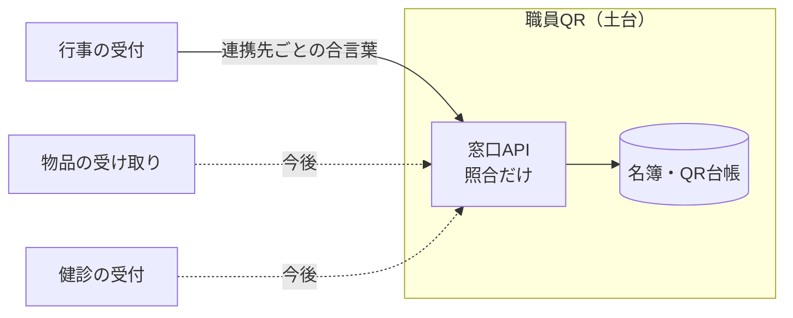

職員の名札にQRコードを載せる仕組みを作っています。研修会や会議の出席を、会場のパソコンでQRを読むだけで記録するためです。

作っているうちに、周りからこういう声が出てきました。

- 「そのQRで、業務システムにログインできたら楽なのに」
- 「部屋の入室にも使えないか」
- 「制服の申し込みの本人確認にも使えそう」

どれも、**やってはいけない使い方**です。この記事では、印刷したQRがなぜ鍵にならないのか、それでも何に使えるのかを整理します（仕組みはテスト用の環境で動かしている段階です）。

## 印刷したQRは、写真1枚で複製できる

理由は単純です。紙に印刷したQRは、**スマートフォンで写真を撮れば、それで複製が完成します**。

- 名札は首から下げて、人に見せるものです。休憩室の机に置くこともあります
- 写真に撮られても、本人は気づきません
- 中身がずっと同じなので、撮った写真はいつまでも使えます

もしこのQRでログインできるなら、**名札の写真＝その人のパスワード**です。

よく「QRは偽造されやすい」と言われますが、QRという形式が弱いわけではありません。弱いのは、**紙に印刷した、ずっと同じQRを鍵として使う**ことです。

## QRには「意味のない番号」だけを入れる

まず、QRに何を入れるかを決めました。

| 入れる候補 | 判断 |
|---|---|
| 職員番号 | 入れない。名札を拾われると誰か分かる |
| 氏名 | 入れない。同上 |
| **意味のない番号（トークン）** | **これだけ入れる**。照合はシステム側の一覧で行う |

トークンは、それ単体では誰のものか分かりません。名札をなくしたら再発行して、古いトークンを無効にします。

ただし、これで「鍵として使える」ようになるわけではありません。トークンに意味が無くても、**写真で複製できる**ことは変わらないからです。

## 使ってよい場面の3条件

そこで、職員QRは**鍵ではなく、記録の道具**と決めました。使ってよい場面は、次の3つをすべて満たすときだけです。

1. **人が見ている前で読む**：受付の職員や周りの人が、読ませている人を目で見ている
2. **なりすまされても、被害が小さい**：他人の名札で記録されても、取り返しのつかないことにならない
3. **権限を与えず、記録するだけ**：読んだ結果、何かが開いたり、何かができるようになったりしない

| 場面 | 1 人が見ている | 2 被害が小さい | 3 記録だけ | 判断 |
|---|---|---|---|---|
| 研修会・会議の出席 | ○ 受付で読む | ○ | ○ | 使ってよい |
| 物品の受け取り確認 | ○ 窓口で読む | ○ | ○ | 使ってよい |
| 備品・鍵の貸し出しと返却の記録 | ○ | ○ 物は窓口から渡す | ○ | 使ってよい |
| 健診・予防接種の受付 | ○ | ○ | ○ | 使ってよい |
| 災害時の参集確認 | ○ | ○ | ○ | 使ってよい |
| 業務システムのログイン | × 1人で操作する | × | × 中に入れる | **使わない** |
| 部屋の入室 | × 無人の扉 | × | × 扉が開く | **使わない** |
| 申し込みの本人確認 | × 自分のスマホから | △ | × 他人の申請が見える | **使わない** |

出席の記録なら、もし誰かが他人の名札で記録しても、受付の人が見ていますし、記録が1件ずれるだけです。ログインや入室は、読ませた瞬間に**権限が渡る**ので、写真1枚で突破されます。

## 鍵が要る場面は、別の手段にする

「使わない」とした場面には、別の手段を割り当てました。

| 場面 | 手段 | 理由 |
|---|---|---|
| 業務システムのログイン | **ICカード** | 中身を写真で複製できない |
| 自分たちのシステムでの本人確認 | **本人の端末に出る、短時間で変わるコード** | 決済アプリが会計のときに出すコードと同じ考え方。写真に撮っても、すぐ使えなくなる。最初に1回だけ端末を登録する |

ポイントは、**毎回変わる**か、**複製できない**かのどちらかです。印刷したQRはどちらも満たしません。

## 落とし穴：キーボード方式のリーダーで「秘密」を打たせる

会場のQRリーダーは、USBでつなぐと**キーボードとして文字を打つ**方式のものを使っています。読んだ中身を、入力欄にキーボードで打ったのと同じように送ってきます。

これを応用して、「既存のソフトのパスワード欄に、リーダーでパスワードを打たせればいい」という案も出ました。これは**かえって弱くなります**。

- QRの中に、**パスワードそのもの**が入ることになる
- 名札の写真を撮られた時点で、パスワードが漏れる
- しかもパスワードは変えにくい（変えるたびに名札を刷り直す）

キーボード方式で既存のソフトに打たせてよいのは、**相手のソフトが毎回変わる値を自分で確かめる場合だけ**です。固定の秘密を打たせてはいけません。

## 実装で気をつけたこと

### 日本語入力がオンでも化けないように

キーボード方式のリーダーは、パソコン側で日本語入力がオンになっていると、全角の文字が入力欄に入ることがあります。受け取った文字は、**半角に直してから照合**しています。

### 職員を確かめる仕組みを、使い道と分ける

最初は、行事の受付システムの中にQRの発行と照合も入れていました。ところが、物品の受け取りや健診の受付など、**職員を確かめる場面**はこれから増えます。そのたびに名簿と照合の仕組みを作り直すと、名簿を書き換えられる場所が増えて危険です。

そこで、2つに分けました。

- **土台**だけが、名簿とQR台帳を書き換えられる
- **使い道**は、土台のシートを直接開かず、窓口（API）を通して照合する
- 連携先ごとに別の合言葉を持たせ、土台はそのハッシュだけを保存する。連携先ごとに個別に止められる
- 窓口の記録に残すのは「日時・連携先・種類・件数」だけ。職員の情報は書かない

### 通信の失敗を「未登録」と決めつけない

会場のパソコンから土台への問い合わせが失敗したとき、「登録されていない職員です」と表示すると、現場で誤った案内をしてしまいます。**無効・未登録・通信の失敗は別の状態**として扱い、通信の失敗は送信待ちに戻しています。

## まとめ

- 印刷したQRは**写真1枚で複製できる**。ずっと同じQRを鍵に使うと、名札の写真がパスワードになる
- QRには意味のない番号だけを入れる。それでも鍵にはならない
- 使ってよいのは、**①人が見ている前で ②なりすまされても被害が小さく ③記録するだけ**の場面
- 鍵が要る場面は、**ICカード**か**毎回変わるコード**にする
- キーボード方式のリーダーで固定の秘密を打たせると、かえって弱くなる

QRを使うかどうかではなく、**読ませた結果、何が起きるか**で決めると、迷わなくなりました。

### 2026-10-14 ナギ：確認前に公開された

- frontmatter に `published: true` を書いていたため、`zenn_publish.js`（150行目）が承認前に commit → User が Gemini 記事の push をしたときに一緒に公開された
- User 判断＝このまま公開（2026-10-14）。公開版は vault 最新版と本文差分0を確認
