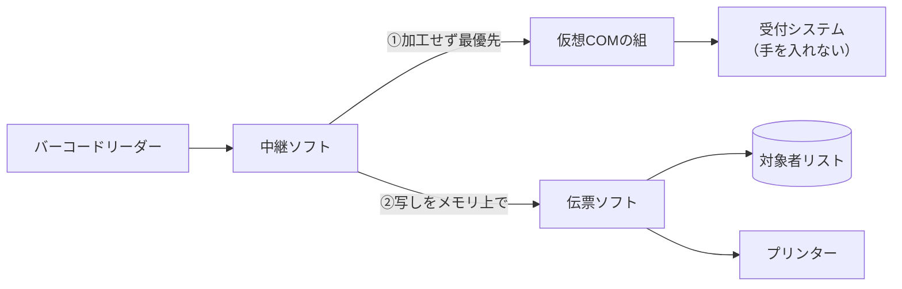

業務の現場には、**中身に手を入れられないシステム**がたくさんあります。業者の製品なので改修できず、頼めば費用も時間もかかります。

それでも「この条件のときだけ、ついでにこれをしてほしい」という要望は出てきます。この記事では、既存システムには一切手を入れずに機能を足す**「中継」パターン**を、私が作っている外来受付の仕組み（現在は試験運用中）を例に整理します。

## やりたかったこと

外来の受付機は、患者さんが診察券のバーコードを読ませると、受付システムに受付が入る仕組みです。

- 「カウンセリングだけ」「検査だけ」の患者さんも、会計のために受付機を通す
- 通すと通常の受付として流れるので、**職員が目で見つけて例外扱い**にしていた
- これを、**対象の患者さんのときだけ専用の伝票を自動で印刷**する形にしたい

制約はこうでした。

- 受付システムには手を入れられない（業者の製品）
- 院内のパソコンだけで完結させる（クラウドは使わない）
- 患者番号をディスクやログに残さない

## 捨てた案

最初からきれいな答えが出たわけではありません。

| 案 | 捨てた理由 |
|---|---|
| キーボード入力を横で拾う（フック） | リーダーが実は**シリアル方式**で動いていて、拾えなかった。キーロガー扱いされるおそれもある |
| 受付システムが書き出すファイルを見張る | 書き出しのタイミングと形式を相手に握られる。番号がファイルに残る |
| 変換器2本とケーブルでポートを分岐する | 機器が増えると故障点が増える |
| 仮想シリアルポートのドライバーを自作する | 今のWindowsでは、カーネルドライバーに審査付きの署名が要る。費用・審査に加え、不具合が出るとOSごと止まる |

1つ目の教訓は、**「キーボードと同じように動く」と思われている機器を、まず疑う**ことでした。デバイスマネージャーとメモ帳で、実際にどう入力されているかを先に確かめるべきでした。

## 中継パターン：入口に挟んで、本線は先に流す

最終的な形はこうです。



リーダーと受付システムの間に**中継ソフト**を挟みます。中継ソフトと受付システムは、ソフトで作る**仮想シリアルポートの組**でつなぎます。受付システムから見ると、今までどおりシリアルポートからバーコードが届くだけです。

この形は、受付システムの業者から提案してもらったものです。**相手の製品の仕様に沿った形にしておくと、あとで保守の相談がしやすくなります。**

## 設計原則

このパターンで大事なのは、中継を挟むことそのものより、**本線（既存の流れ）を絶対に止めない**ための決まりです。

### 1. 本線へは「加工せず・先に」流す

受け取ったバイトは、何も変えずに、まず受付システムへ送ります。伝票の処理はその後です。

中継が値を読み換えたり、区切りを整えたりすると、**既存システムの動きが変わってしまいます**。中継は「通すだけ」に徹します。

### 2. 写しは別の流れにし、待ち行列に上限を付ける

```csharp
// 考え方を示す簡略版
void OnReceived(byte[] data)
{
    mainLine.Write(data, 0, data.Length); // ① 本線が先
    if (!copyQueue.TryAdd(data))          // ② 写しは上限付きの待ち行列へ
    {
        droppedCount++;                   //    溢れたら写しを捨てる。本線は待たせない
    }
}
```

写しの処理（照合・印刷）は別のスレッドで、上限付きの待ち行列から取り出して行います。プリンターが詰まっても伝票ソフトが落ちても、**受付は止まりません**。溢れたときに捨てるのは写しのほうです。

### 3. 出口が使えないうちは、入口を開かない

逆向きの事故もあります。受付システム側のポートが使えない状態で中継がリーダーを開くと、**読んだバーコードが中継で消えてしまいます**。中継は、出口が確保できてから入口を開きます。

### 4. 写しはディスクに書かない

中継から伝票ソフトへは、**名前付きパイプ**で渡しています。最初は一時ファイルで渡す案もありましたが、それだと患者番号がディスクに残ります。メモリ上で受け渡せば残りません。

### 5. 調べるためのログに、中身を残さない

動かないときの調査には記録が要ります。ただし残すのは、

- 当日の受信バイト数
- 最後に受け取った時刻
- 区切りのエラーの種類

だけです。番号そのものは書きません。「届いているか」「どこで切れているか」は、中身がなくても切り分けられます。

### 見本：受信したバイトを16進数で見る

中身を残さずに切り分けるため、試験用に「受け取ったバイトを16進数で画面に出すだけ」の小さな受け側ソフトを作りました（表示はメモリ上だけで、ファイルには残しません）。見え方はこうです（値は架空です）。

```
[10:02:15] 受信 9バイト: 30 31 32 33 34 35 36 0D 0A   ← 7桁＋CR LF。正常
[10:02:31] 受信 3バイト: 30 31 32
[10:02:31] 受信 6バイト: 33 34 35 36 0D 0A           ← 1回の読み取りが2回に分かれて届いた
[10:03:02] 受信 8バイト: 30 31 32 33 34 35 36 0D      ← 終わりが CR だけ
```

- `30`〜`39` は数字の `0`〜`9`、`0D` は CR、`0A` は LF（どちらも改行の文字）です
- **2行目と3行目**：シリアル通信では、1回の読み取りが1件分とは限りません。「受け取るたびに1件」と扱うと、`012` と `3456` の2件に割れてしまいます。終わりの文字が来るまでためてから1件にします
- **4行目**：機器の設定で、終わりが CR だけのことがあります。LF を待つ作りだと、いつまでも1件が終わりません

この画面は試験用で、読ませるのはダミーのバーコードだけです。本番で調べるときは、前の節の「件数・時刻・区切りのエラーの種類」だけを見ます。区切りのずれは、ダミーで再現すれば、本物の番号を見なくても確かめられます。

### 6. うっかり止まらないようにする

常駐ソフトは、×ボタンで閉じても止まらず、タスクトレイにしまうようにしました。止めるのは、設定画面から「止めて」という合図を送ったときだけです。現場の誰かが何気なく閉じて、受付が止まる事態を防ぐためです。

## 現場で見つかったこと

試験中に、**リーダーとUSBメモリを挿す順番によって、ポートが「切断」と表示される**現象が起きました。

ソフトの設計では防げない種類の問題なので、本番前のチェックリストに「挿す順番と場所」を加えました。

## まとめ

改修できないシステムに機能を足すときは、

1. **入口に中継を挟み**、既存システムからは今までと同じに見せる
2. 本線へは**加工せず先に**流す
3. 追加の処理は**写し**で行い、止まっても本線を巻き込まない
4. 出口が使えないうちは入口を開かない
5. 写しもログも、**中身をディスクに残さない**

という順で考えると、業者のシステムに1行も触れずに済みます。シェルの `tee` コマンドや、ネットワークの TAP と同じ発想です。

この仕組みはまだ試験運用中です。本番で動かした結果は、稼働後に改めて書きます。
