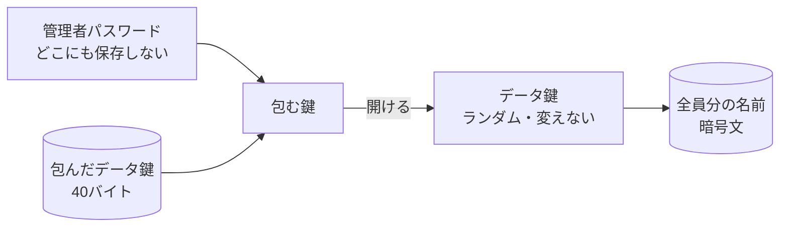

個人情報を暗号化して保存する仕組みを作ると、最初に思いつくのは「管理者パスワードから鍵を作って、そのまま名前を暗号化する」形です。

動きはします。ただ、運用に入ると次のような場面で困ります。

- 管理者が交代したので、パスワードを変えたい
- 管理者を1人増やしたい。でも同じパスワードを共有したくない
- 同じデータを、別のパソコンからも読みたい

この記事では、こうした変更を**データに触れずに**済ませる「データ鍵を包む」設計（エンベロープ暗号化とも呼ばれます）を、私が社内向けに作っている業務システム（スプレッドシート＋Google Apps Script と、Windowsの常駐ツール）を例に整理します。

前の記事「[患者番号や職員番号を「照合できるが、漏れても読めない」形で持つ](https://zenn.dev/kimshoshi/articles/short-id-hash-is-not-protection)」で、最後に「別の記事で書く」とした部分です。

## パスワードで直接暗号化すると、何が困るか

パスワードから作った鍵で名前を直接暗号化すると、**パスワードと暗号文が1対1で結びつきます**。

| やりたいこと | パスワードで直接暗号化した場合 |
|---|---|
| パスワードを変える | 全員分を古い鍵で開け、新しい鍵で暗号化し直して、シートに書き戻す |
| 管理者を増やす | 同じパスワードを教えるしかない |
| 管理者が辞めた | パスワードを変える＝全員分の書き直し |
| 別の端末でも読む | その端末でもパスワードを入れる |

ここで誤解しやすいのですが、**困るのは計算の速さではありません**。手元で試すと、1000件を暗号化し直すのにかかったのは22ms（Apple M1・Node.js）でした。

困るのは**全件を書き直すこと**そのものです。途中で止まれば、古い鍵の行と新しい鍵の行が混ざります。書き直している間に誰かが申請すれば、その行はどちらの鍵で暗号化されたのか分からなくなります。パスワードを変えるたびに、こうした危ない作業が発生します。

## データ鍵を1つ作り、それを「包む」

解き方は、鍵を2段にすることです。

1. **データ鍵**：ランダムに作った鍵。名前の暗号化にはこれだけを使う。一度作ったら変えない
2. **包む鍵**：管理者パスワードから作る鍵。**データ鍵を暗号化する（包む）ためだけ**に使う

保存するのは「包んだデータ鍵」（数十バイト）だけです。パスワードもデータ鍵も、そのままの形ではどこにも保存しません。



こうすると、さきほどの表が次のように変わります。

| やりたいこと | データ鍵を包む場合 |
|---|---|
| パスワードを変える | 古いパスワードで包みを開け、新しいパスワードで包み直す。**名前の暗号文には触れない** |
| 管理者を増やす | 同じデータ鍵を、その人のパスワードで**もう1つ包む** |
| 管理者が辞めた | その人の包みを消す（※後述の限界あり） |
| 別の端末でも読む | その端末専用の保護で**もう1つ包む** |

書き換わるのは、包みの1行だけです。

## コード：ブラウザの標準機能だけで書く

暗号の部品は自作しません。ブラウザ（と Node.js）に標準で入っている Web Crypto API だけで書けます。以下は説明用に書き下ろした最小の例です。

### パスワードから「包む鍵」と「確認用の値」を作る

```js
const { subtle } = globalThis.crypto;
const enc = new TextEncoder();

async function fromPassword(password, salt) {
  const base = await subtle.importKey('raw', enc.encode(password), 'PBKDF2', false, ['deriveBits']);
  const bits = new Uint8Array(await subtle.deriveBits(
    { name: 'PBKDF2', hash: 'SHA-256', salt, iterations: 600_000 }, base, 512));

  // 前半256ビット＝包む鍵（ブラウザから出さない）
  const wrappingKey = await subtle.importKey('raw', bits.slice(0, 32), 'AES-KW', false, ['wrapKey', 'unwrapKey']);
  // 後半256ビット＝サーバーへ送る確認用の値（サーバーはこのハッシュだけを持つ）
  const authValue = bits.slice(32);
  return { wrappingKey, authValue };
}
```

1回の計算から、**役割の違う2つの値**を切り出しています。

- **包む鍵**はブラウザの中だけで使い、サーバーに送りません
- **確認用の値**はサーバーに送り、「パスワードが正しいか」の判定に使います。サーバーが持つのはそのハッシュだけです

サーバーは「パスワードが合っているか」は分かりますが、「包みを開ける鍵」は持っていません。サーバーのアカウントを乗っ取られても、それだけでは名前は読めません。

### 初回：データ鍵を作って包む

```js
async function setup(password) {
  const salt = crypto.getRandomValues(new Uint8Array(16));
  const dataKey = await subtle.generateKey({ name: 'AES-GCM', length: 256 }, true, ['encrypt', 'decrypt']);
  const { wrappingKey, authValue } = await fromPassword(password, salt);
  const wrapped = new Uint8Array(await subtle.wrapKey('raw', dataKey, wrappingKey, 'AES-KW'));
  return { salt, wrapped, authValue }; // salt と wrapped を保存する。どちらも秘密ではない
}
```

### 毎回：包みを開ける（取り出せない形で）

```js
async function open(password, salt, wrapped, extractable = false) {
  const { wrappingKey } = await fromPassword(password, salt);
  return subtle.unwrapKey('raw', wrapped, wrappingKey, 'AES-KW',
    { name: 'AES-GCM', length: 256 }, extractable, ['encrypt', 'decrypt']);
}
```

ふだんは `extractable = false` で開けます。こうすると、開けたデータ鍵はブラウザの中で**使えるが、中身を取り出せない**状態になります。画面の中で動くスクリプトに不具合があっても、データ鍵そのものを書き出すことはできません。

### パスワード変更：開けて、包み直すだけ

```js
async function changePassword(oldPw, newPw, salt, wrapped) {
  const dataKey = await open(oldPw, salt, wrapped, true); // この時だけ取り出せる形で開ける
  const newSalt = crypto.getRandomValues(new Uint8Array(16));
  const { wrappingKey, authValue } = await fromPassword(newPw, newSalt);
  const newWrapped = new Uint8Array(await subtle.wrapKey('raw', dataKey, wrappingKey, 'AES-KW'));
  return { salt: newSalt, wrapped: newWrapped, authValue };
}
```

手元で動かした結果です。

```
包み直し(ms) 289 wrapped bytes 40
新パスワードで復号: 山田 太郎
旧パスワード: OperationError
取り出し: InvalidAccessException
```

- 包み直しは約0.3秒。ほとんどが、パスワードからの計算をわざと遅くしている分（60万回）です
- 新しいパスワードで、**変更前に暗号化した名前**がそのまま読めます
- 古いパスワードでは開けません（AES-KW は包みが壊れていないかも確かめるので、間違った鍵ではエラーになります）
- ふだんの形で開けたデータ鍵は、取り出そうとしても拒否されます

## 包みは何通りでも持てる：端末の保護と合言葉

同じ考え方を、Windowsの常駐ツールでも使っています。こちらは院内の共有フォルダにある対象者データを、決まった数台のパソコンで毎日読む仕組みです。

毎朝パスワードを入れてもらうのは現実的ではありません。そこで、1つのデータ鍵を**2通りで包んで**います。

| 包み方 | 使う場面 |
|---|---|
| 端末ごとのOS標準の保護（その端末でしか開けない） | 毎日の動作。何も入力しない |
| 管理者の合言葉 | 端末を足す・入れ替えるときだけ |

新しい端末を足すときは、合言葉で包みを開け、その端末の保護でもう1つ包んで保存します。ほかの端末やデータには触れません。

ここでも部品は自作していません。古い実行環境には AES-GCM のような「暗号化と改ざん検出が一体になった方式」が無かったので、**標準の暗号化と、標準の改ざん検出を組み合わせて**使っています。

## サーバーの「確認」は、共通の入口で数える

パスワードの確認には、失敗回数の制限（何回か間違えたら一定時間ロック）をかけます。ここで一度、レビューで指摘を受けました。

最初は、回数制限を**ログイン画面の処理にだけ**置いていました。ところが Google Apps Script の Web アプリでは、画面から呼べる関数は、画面を通さずに直接呼ぶこともできます。ログイン画面を飛ばして、別の管理用の関数に間違ったパスワードを何度でも送れてしまいます。

直し方は、回数制限を**すべての管理用の処理が必ず通る、共通の認証の関数**に移すことでした。

> 回数制限は「入口の画面」ではなく、「守りたい処理が必ず通る部品」に置く。

この指摘をくれたのは、設計とレビューを受け持たせている AI です。実装を受け持つ AI とは分けているので、書いた本人では気づきにくい抜け道が見つかりました。

## この設計で守れないもの

- **辞めた管理者の包みを消しても、その人がデータ鍵を覚えていれば読めます**。包みを消すのは「これから先、その人のパスワードで開けなくする」ことであって、「すでに知っている鍵を忘れさせる」ことではありません。本当に締め出すなら、データ鍵そのものを作り直して全件を暗号化し直す必要があります（このときだけは、書き直しを避けられません）
- **包みが1つしかないと、パスワードを忘れた時点で全員分が読めなくなります**。管理者用の包みは、2つ以上持つのが安全です（例：予備の合言葉を紙に書き、封をして保管する）
- 画面に表示した名前は、その画面を見ている人には読めます。暗号化は保存場所の守りです

## まとめ

- パスワードで直接データを暗号化すると、パスワードの変更や管理者の交代のたびに**全件の書き直し**が発生する。問題は速さではなく、書き直しの危うさ
- ランダムな**データ鍵**を1つ作り、パスワードから作った鍵で**包んで**保存する。変更は包み直しだけ
- 包みは何通りでも持てる。管理者ごと、端末ごとに包めば、毎日の手間なしで追加や交代に対応できる
- パスワードからは「包む鍵」と「確認用の値」を分けて作り、サーバーには包む鍵を渡さない
- 回数制限は、守りたい処理が必ず通る共通の部品に置く

